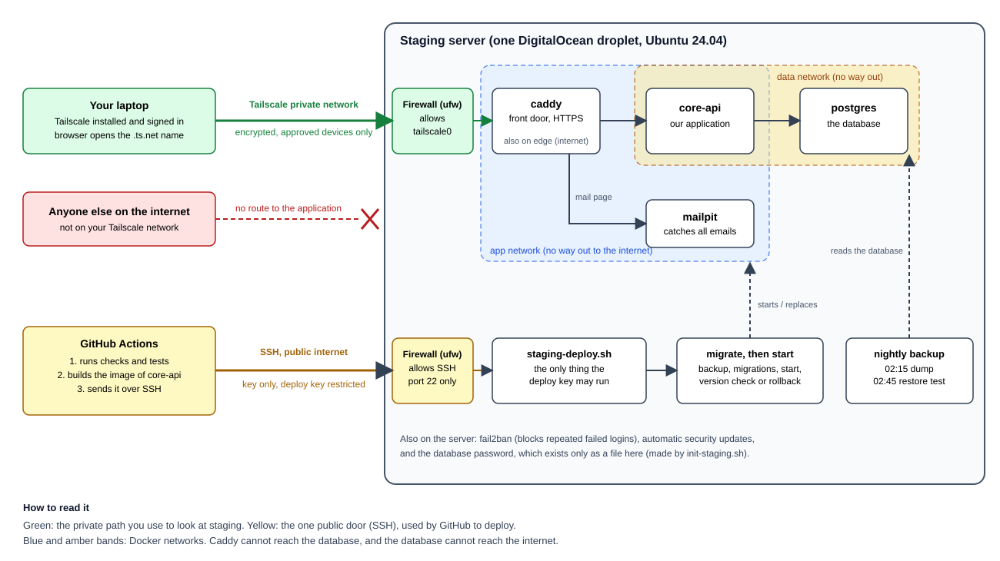

# 8. Staging and Tailscale, explained from zero

This page assumes you have never rented a server, never used a private network and never read a
Compose file. Read it once from top to bottom. Afterwards, the runbook
([staging.md](../runbooks/staging.md)) and the decision record
([ADR 0005](../adr/0005-staging-environment.md)) will make much more sense.

Nothing described here has run on a real server yet. The scripts were tested against a fake Docker, so
expect small surprises on the first real run. The last section says which ones are likely.

## 1. What staging is, and why it exists

Your laptop runs the application for you, alone, with data you can break. Production will run it for
the Ministry, with real scholars. Between the two you want a place that looks like production but holds
nothing real. That place is staging.

It answers one question before every release: does this work on a real server, started the way
production will be started? Things that pass on a laptop and fail on a server are common. A missing
setting, a file permission, a port that is not open, a database that has not started yet. Staging
finds them while nobody is hurt.

Staging holds synthetic data only. That is a rule, not a hope: nothing real may be copied there.

## 2. The pieces, in one picture

```
 Your laptop                                      GitHub
 (Tailscale installed)                            (builds and tests the code)
      |                                                |
      |  private network (Tailscale)                   |  SSH, with the deploy key
      |                                                |  (sends the new version)
      v                                                v
 +----------------------------- one server (a DigitalOcean droplet) ------------------------+
 |                                                                                          |
 |   Tailscale ---- firewall (ufw) ---- SSH ---- deploy script ---- nightly backup          |
 |                                                                                          |
 |   Docker                                                                                 |
 |     +---------+      +----------+      +-------------+                                  |
 |     |  caddy  | ---> | core-api | ---> |  postgres   |      +---------+                 |
 |     +---------+      +----------+      +-------------+      | mailpit |                 |
 |     front door        our application   the database        +---------+                 |
 |                                                              catches emails             |
 +------------------------------------------------------------------------------------------+
```



Three ideas carry the whole design:

1. One small server, rented by the month, that we can destroy and rebuild from a file.
2. The application is reachable only from machines you have approved (Tailscale).
3. Everything runs in containers, started by one file (Docker Compose).

The rest of this page takes them in turn.

## 3. The server (a droplet)

A server is a computer that stays on and is reachable over a network. You do not buy one. You rent a
small slice of a big machine from a company. DigitalOcean calls such a slice a droplet. Ours is the
cheap size: 1 processor, 2 GB of memory, running Ubuntu 24.04 (a version of Linux).

You never touch the screen or keyboard. You reach it by typing commands over SSH, which is a way of
running a terminal on another computer. The first time you connect, you will see a plain Linux prompt,
the same kind you would see on your own Linux machine.

### Why one server and not something bigger

Because staging has one user (you) and a handful of requests. Kubernetes or a cluster would add weeks of
learning and nothing useful. ADR 0005 gives the longer argument. The honest tradeoff: when this server
dies, staging is down until you rebuild it. For staging that is acceptable. For production it would not
be, and production will be designed separately.

## 4. cloud-init: a server that builds itself

When you create the droplet, DigitalOcean lets you paste a file into a box called "user data". On first
start, a program called cloud-init reads that file and does what it says, once. Ours installs Docker,
Tailscale, the firewall and fail2ban, creates two users, writes our scripts onto the disk and schedules
the nightly backup.

Why not install these by hand over SSH? Because by hand you forget what you did. With a file you can
destroy the server and create an identical one in ten minutes. The file is kept in the repository
(`infra/staging/cloud-init.template.yaml`), so a change to the server is a change you can review, like a
change to code. This idea is called infrastructure as code.

`npm run render:cloud-init` builds the final file by pasting our scripts into the template. You then
replace two placeholders with your public keys and paste the result into DigitalOcean.

## 5. Tailscale

### The problem it solves

A server on the internet gets attacked within minutes of existing. Bots try common passwords and known
bugs on every address they can find. The usual defence is to expose as little as possible.

For staging, the best answer is to expose nothing at all to the public, and still let you and your
colleagues use it from anywhere. Tailscale does that.

### What it is

Tailscale makes a private network that exists only between machines you have approved. Think of a
building with one locked door and a guest list. Your laptop, your phone and the staging server each run
the Tailscale program and sign in to the same account. Once signed in, they can reach each other as if
they were plugged into the same switch, wherever they really are. Everyone else on the internet cannot
see that network at all.

How it works underneath, in plain terms:

- Every approved machine gets a private address that looks like `100.64.12.34`. These addresses mean
  something only inside your network.
- A central service run by Tailscale acts as a switchboard. Each machine tells it "I am here, this is
  my key". The switchboard tells the others how to find it. It does not carry your traffic.
- The machines then talk to each other directly, encrypted with keys that only they hold. The
  technology for this is called WireGuard. You do not need to learn it, only to know that the traffic
  between your laptop and staging is encrypted even before our own HTTPS is added.
- If two machines cannot connect directly (some office networks prevent it), Tailscale relays the
  encrypted traffic through its own servers. They cannot read it.

The free plan is enough for this. It allows a small number of users and many devices.

### MagicDNS and the name ending in `.ts.net`

Typing `100.64.12.34` is painful and changes meaning if the server is rebuilt. MagicDNS gives each
machine a name instead. Our server is called `sms-staging`, and its full name looks like
`sms-staging.tail1234.ts.net`. The `tail1234` part is chosen by Tailscale for your account.

The runbook asks you to switch on **MagicDNS** and **HTTPS Certificates** in the Tailscale admin
console. The second switch lets Tailscale obtain a real HTTPS certificate for that name, so your browser
shows the padlock and no warning. Without it, browsers would complain, and the application's cookies
(later) would not behave like production.

### Two practical consequences

- To open staging, **your own computer must have Tailscale installed and be signed in**. If it is off,
  the staging address simply does not answer, which is exactly the point. Anyone else who needs access
  must be invited to your Tailscale account.
- Key expiry. Tailscale machines must renew their login about every six months. A server that nobody
  renews drops off the network. The runbook tells you to disable key expiry for the server for this
  reason.

### What Tailscale does not protect (read this part)

It is easy to leave with the idea that "everything is behind Tailscale". That is not quite true here.

The server has one door open to the public internet: **SSH on port 22**. GitHub needs it, because GitHub's
build machines are not on your Tailscale network, so they reach the server over the public internet to
send a new version. We protect that door in five ways: only key logins are allowed (no passwords), root
cannot log in, only two named users may log in, fail2ban bans addresses that keep guessing, and the
deploy key is restricted (section 7). That is good protection, but it is not invisibility. Be clear
about the difference: the **application** is private, the **SSH door** is public and hardened.

If you later want the SSH door private too, the usual route is to give GitHub a Tailscale identity for
the duration of a job. That is a worthwhile change for production and has a cost in complexity, which
is why it is not in this first version.

## 6. The server protects itself

Three small programs run on the server.

**ufw** is the firewall, a list of rules about which connections the server accepts. Ours says: refuse
everything coming in, except SSH and anything arriving through the Tailscale network card
(`tailscale0`). Everything going out is allowed.

**fail2ban** reads the login log. If one address fails to log in four times, it blocks that address for
an hour. Bots give up quickly.

**unattended-upgrades** installs security updates for the operating system by itself.

DigitalOcean also has its own firewall outside the server. We open port 22 there and nothing else. Two
walls are better than one, because a mistake in one is often caught by the other.

There is one trap worth knowing, because it surprises experienced people too. Docker, when it publishes
a port, writes its own firewall rules that sit **before** ufw. A container started with
`ports: "443:443"` would be open to the whole internet even though ufw says "deny". That is why the
Compose file always writes `"${TAILSCALE_IP}:443:443"`, which means "publish this port only on the
Tailscale address". Do not remove the address from those lines. A check in the repository fails the
build if someone does.

## 7. The two users and the restricted key

The server has two people-shaped accounts.

- `admin` is you. It logs in with your own SSH key and can use `sudo` (administrator powers). You use it
  to set things up and to look around.
- `deploy` belongs to GitHub. It logs in with a different key, which lives in GitHub's secret store.

An SSH key is a pair of files. The private half stays with its owner. The public half is placed on the
server. The server can then check that you hold the private half without you ever sending it.

The `deploy` key is special. In the server's list of allowed keys, its line begins with
`restrict,command="/opt/staging/bin/staging-deploy.sh"`. That means: whoever logs in with this key
cannot get a terminal and cannot run anything they like. The server runs that one script and nothing
else, whatever the visitor asked for. The script accepts exactly three requests: `deploy <commit>`,
`rollback` and `status`.

Why bother? Because the key sits in GitHub. If someone ever stole it, the worst they could do is deploy
a version of our own code. They could not read the database or install anything. Giving automation the
smallest power that lets it do its job is a habit worth keeping everywhere.

Before you ever trust the server, the runbook asks you to compare its **fingerprint** on the server and
from your laptop. This is how you know the machine you reach is really yours and not an impostor in
between.

## 8. Docker and Compose

### Containers

A container is an application packed together with everything it needs, started in a sealed box. The
box cannot see the rest of the server unless we allow it. The same image (the packed form) runs the same
way on your laptop, in CI and on the server. That is what ends "it works on my machine".

Docker is the program that builds and runs containers. Docker Compose reads one file, `compose.yaml`, and
starts several containers together in the right way. Our file describes four.

### The four containers (and one short-lived job)

| Container | What it is | Why it is there |
|---|---|---|
| `caddy` | A reverse proxy | The front door. It accepts HTTPS from outside, then forwards the request to `core-api`. |
| `core-api` | Our application | The staff API we are building. |
| `migrate` | A one-off job | Not running all the time. A deployment starts it for a few seconds to change the database, then it exits. |
| `postgres` | The database | Where the data lives, on a disk volume that survives restarts. |
| `mailpit` | A mail catcher | Staging must never email real people. Everything the application sends lands here, and you read it in a web page. |

### What a reverse proxy does

Your application speaks plain HTTP and does not want to manage certificates. Caddy stands in front. It
holds the HTTPS certificate (obtained from the local Tailscale), decrypts the request, adds security
headers and passes it to `core-api`. Caddy is also the only container that listens for outside
connections, so there is exactly one place where traffic enters.

That is also why the application is configured with `TRUST_PROXY=true`. Behind Caddy, every request
appears to come from Caddy. With that setting, the application believes the address Caddy reports in
the `x-forwarded-for` header. Without it, every client would look like one address and the rate limiter
would treat everybody as a single person.

### Three networks, and why

Compose lets us draw private roads between containers.

```
internet-capable            no route to the internet           no route to the internet
     edge                            app                              data
   [ caddy ] ------------------- [ caddy ] [ core-api ] [ mailpit ]
                                              [ core-api ] ------- [ postgres ]
```

- `edge` has a way out to the internet. Only `caddy` is on it, because it needs to fetch things.
- `app` is internal: containers on it can talk to each other and to nothing outside. `caddy`, `core-api`
  and `mailpit` are on it.
- `data` is internal too. Only `core-api` and `postgres` are on it.

The consequence: `caddy` cannot reach the database, and the database cannot reach the internet. A
compromise of one container does not hand over the others. This is a small version of the two-zone idea
of the whole project.

### Hardening on every container

You will see these lines repeated. They mean: `cap_drop: [ALL]` removes special Linux powers the
container does not need; `no-new-privileges` stops a process from gaining more rights than it started
with; `read_only: true` makes the application's files unwritable; `mem_limit` stops one container from
eating all the memory.

### Secrets

The database passwords are not in the repository and not in environment variables. A script
(`init-staging.sh`) creates two of them on the server, once, as files in a locked folder: one for the owner
of the database (who may change its structure) and one for the role the application uses (who may only work
with rows, and only the rows the policies allow). Compose mounts each file into the containers that need it.
The application can read only its own, so a flaw in the application cannot hand over the owner's power.
The passwords therefore exist in one place only, the server. Nobody, including you, needs to know them.

## 9. Follow one request

Say you open `https://sms-staging.tail1234.ts.net/api/...` in your browser.

1. Your laptop asks MagicDNS for the name and receives the server's Tailscale address.
2. Tailscale sends the request, encrypted, straight to the server's `tailscale0` card.
3. ufw sees traffic arriving on `tailscale0`, which is allowed.
4. Docker passes it to port 443 of `caddy`, which is published only on that address.
5. Caddy completes the HTTPS handshake with the Tailscale certificate, then forwards to `core-api:3000`
   over the `app` network.
6. `core-api` runs the request through its checks (the lifecycle in [guide 7](07-fastify.md)). If it needs
   data, it asks `postgres` over the `data` network, as the `sms_app` role.
7. The answer goes back the same way.

From any machine not signed in to your Tailscale network, step 1 already fails.

## 10. Follow one deployment

You merge a change into `main` on GitHub.

1. GitHub Actions runs every check and test. If anything fails, nothing is deployed.
2. The `deploy-staging` job builds the Docker image of `core-api`, saves it as a file
   (`image.tar.gz`) and packs it with `compose.yaml` and the `Caddyfile` into one archive. There is no
   registry in the middle, which keeps the design small.
3. It checks the server's fingerprint against the one you stored, then sends the archive over SSH using
   the deploy key.
4. On the server, `staging-deploy.sh` takes over. It checks that the archive holds exactly three plain
   files, loads the image into Docker and reads the server's Tailscale address.
5. It starts only the database, takes a backup (not the first time, when there is nothing to copy), and runs
   the migrations. A migration is a numbered SQL file that changes the shape of the database. They run from a
   one-off container made from the new image, which also gives the application its database password. The old
   version keeps serving while this happens. If a migration fails, the script stops there and nothing new starts.
6. It then runs `docker compose up`, asks the new `core-api` for its `/health` and compares the reported version
   with the commit it just deployed. If the right version answers, the deployment is finished and the previous
   release is remembered.
7. If the new version does not start, it starts the previous release again by itself and reports the failure.
   It does not undo the migration. That is why every migration has to be written so that the old version still
   works with it: add a column first, use it later, remove it only after nothing reads it.

A lock stops two deployments from running at once, and only the last five releases are kept on the disk.

You can also ask for `rollback` or `status` by hand.

## 11. Backups

Every night at 02:15 the server dumps the database to a file. At 02:45 it restores the newest dump into a
throwaway database and checks that it works. A backup that has never been restored is only a hope, so
the second step matters more than the first. The log is `/var/log/staging-backup.log`.

Backups stay on the same server for now. If the server is lost, so are they. For staging, that is
acceptable. For production, copies must go elsewhere (task FN-11).

## 12. What you will do, in order

The runbook has the exact commands. The shape of it:

1. Make two SSH keys on your laptop: one for you, one for GitHub.
2. Create a Tailscale account and switch on MagicDNS and HTTPS Certificates.
3. Install Tailscale on your laptop.
4. Fill in the cloud-init file and paste it into a new droplet.
5. Log in with SSH, wait for cloud-init to finish, run `tailscale up`, approve the machine in the web
   page, disable key expiry.
6. Run `init-staging.sh` with the full `.ts.net` name.
7. Add three entries to the GitHub repository (the deploy key, the host, the host fingerprint).
8. Push, and watch the deployment run.

## 13. What may go wrong on the first run

I would rather tell you now than have you discover it at midnight.

- **The migration step has never run on a real server.** It was tested against a real PostgreSQL on a
  development machine and against a fake Docker, but not inside the image or on the droplet. If the first
  deployment stops at "the database migration failed", the job output says why. `/ready` is the final proof:
  it should answer `{"status":"ready"}`.
- **An image tag may not exist.** The tags of Caddy, PostgreSQL and Mailpit were chosen from memory of
  what exists. The deploy script checks them and stops with a clear message if one is wrong. The fix is
  to edit one line.
- **The Docker build of our own image has not run since FN-05.** GitHub will build it on the next push.
- **Caddy and the Tailscale socket.** Caddy asks the local Tailscale for a certificate through a socket
  file. If the certificate request fails, Caddy's log (`docker compose logs caddy`) says why. The two
  usual causes are HTTPS Certificates not enabled in the console, and a hostname typed wrongly in
  `/opt/staging/.env`.
- **Cost.** A droplet of this size costs a few dollars a month, and you need a payment card to create
  one. That is the one thing blocking FN-03 today.

## 14. Words you will meet

| Word | Meaning |
|---|---|
| Droplet | DigitalOcean's name for a rented virtual server. |
| cloud-init | The program that configures a server on first start from a file you provide. |
| SSH | A way to run commands on another computer over an encrypted connection. |
| Tailscale | A private network between machines you have approved. |
| MagicDNS | Names for machines in that network, such as `sms-staging`. |
| `.ts.net` | The domain Tailscale gives every machine in your network. |
| ufw | The server's firewall. |
| fail2ban | Blocks addresses that keep failing to log in. |
| Container, image | A sealed running application, and the packed form it starts from. |
| Compose | A file that describes several containers and starts them together. |
| Reverse proxy | The front door that receives requests and forwards them inside (Caddy). |
| Volume | A disk area that outlives the container using it. |
| Forced command | An SSH key that can run one named script and nothing else. |
| Rollback | Going back to the previous working release. |

## 15. Where to go next

- The exact steps: [runbooks/staging.md](../runbooks/staging.md)
- Why each choice was made, and what else was considered: [ADR 0005](../adr/0005-staging-environment.md)
- The task record with the known gaps: [tasks/FN-03.md](../tasks/FN-03.md)
- Official starting points: the Tailscale "What is Tailscale" page, the Docker Compose overview and the
  Caddy "reverse_proxy" documentation. Each is short and written for beginners.
